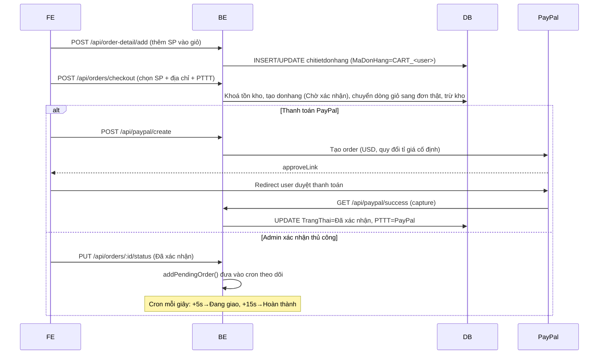

# Tài liệu nghiệp vụ & luồng xử lý — Regional Specialties BE

Tài liệu này mô tả các chức năng nghiệp vụ và luồng xử lý (flow) thực tế của backend, dựa trên việc đọc trực tiếp toàn bộ `src/routes`, `src/controllers`, `src/model`, `src/middlewares`, `src/cron`. Xem [CLAUDE.md](../CLAUDE.md) để biết kiến trúc kỹ thuật/quy ước code.

## 1. Tổng quan hệ thống

Backend cho sàn thương mại điện tử bán đặc sản 3 miền (Bắc/Trung/Nam), gồm 2 nhóm sản phẩm: `tai_cho` (đồ tươi) và `do_kho` (đồ khô/bảo quản lâu). Hai vai trò người dùng: **user** (khách hàng) và **admin** (quản trị viên bán hàng). Không có vai trò "shipper"/"seller" riêng — mọi thao tác quản trị sản phẩm/đơn hàng đều do `admin` thực hiện.

## 2. Phân quyền theo middleware

| Middleware | Điều kiện | Áp dụng |
|---|---|---|
| `authMiddleware` | Có JWT hợp lệ trong header `Authorization: Bearer <token>` | Hầu hết route trừ đăng ký/đăng nhập, xem sản phẩm công khai, PayPal return/webhook |
| `verifyAdmin` (hoặc `isAdmin`, gần như trùng chức năng) | `req.user.role === "admin"` | Quản lý user, tạo/sửa/xoá sản phẩm, xoá feedback, upload ảnh sản phẩm, thống kê doanh thu |

JWT được ký bằng `JWT_SECRET`, hết hạn sau **10 giờ** (`auth.controller.ts`), payload gồm `id`, `username`, `role`.

## 3. Các module nghiệp vụ

### 3.1 Xác thực & tài khoản (`/api/auth`)

| Method | Endpoint | Quyền | Mô tả |
|---|---|---|---|
| POST | `/register` | public | Đăng ký: sinh `id` ngẫu nhiên 5 chữ số chưa tồn tại, hash password (bcryptjs), tạo đồng thời bản ghi `users` + `khachhang` trong 1 transaction |
| POST | `/login` | public | So khớp password, trả JWT 10h + thông tin cơ bản |
| POST | `/logout` | public | Chỉ trả message, không có blacklist token (client tự xoá token) |
| GET | `/profile` | user | Lấy thông tin `users` JOIN `khachhang` theo id trong token |
| PUT | `/users/:id` | user | Cập nhật thông tin giao hàng của khách (SĐT, tỉnh/thành, phường/xã, địa chỉ chi tiết, toạ độ); tự INSERT `khachhang` nếu chưa có (auto-provision), có transaction |
| POST | `/forgot-password` | public | Xem 3.2 |
| POST | `/reset-password` | public | Xem 3.2 |

### 3.2 Quên / đặt lại mật khẩu

Đây **không phải** flow gửi link reset thông thường mà là flow "gửi mật khẩu tạm qua email":

1. `POST /api/auth/forgot-password` (email) → hệ thống sinh **mật khẩu mới ngẫu nhiên 8 ký tự hex**, hash và **ghi đè trực tiếp** vào `users.password`, đồng thời lưu thêm `reset_token`/`reset_expire` (hết hạn sau 15 phút). Gửi email chứa mật khẩu mới (viết hoa) + token.
2. Từ lúc này, mật khẩu tạm **chính là mật khẩu đăng nhập thật** — user có thể login thẳng bằng nó.
3. `POST /api/auth/reset-password` (email, tempPassword, newPassword, confirmPassword) → so khớp `tempPassword` với `users.password` hiện tại (chính là mật khẩu tạm), kiểm tra `reset_expire` chưa hết hạn, rồi đổi sang `newPassword` do user chọn, xoá `reset_token`/`reset_expire`.

⚠️ Lưu ý: bước 3 không thực sự dùng `reset_token` để xác thực (chỉ so `tempPassword` với cột `password`) — token sinh ra ở bước 1 hiện không được kiểm tra ở đâu.

### 3.3 Quản lý người dùng — Admin (`/api/admin`, tất cả route yêu cầu `verifyAdmin`)

CRUD tài khoản (`getAllUsers`, `createUser`, `updateUser`, `deleteUser`) thao tác đồng thời trên `users` và `khachhang`. `deleteUser` là **hard delete** (không soft-delete như sản phẩm) — xoá thẳng khỏi bảng `users`.

### 3.4 Sản phẩm (`/api/sanpham`)

| Method | Endpoint | Quyền | Mô tả |
|---|---|---|---|
| GET | `/` | public | Danh sách sản phẩm chưa xoá (`is_deleted = 0`), lọc theo `?vungmien=` (bac/trung/nam), `?loaidan=` (tai_cho/do_kho), `?keyword=` (LIKE trên `TenSP`/`MoTa`), `?xuatxu=` (LIKE trên `XuatXu`), `?minPrice=`/`?maxPrice=` (khoảng `GiaSauGiam`), `?sort=` (`gia_asc`/`gia_desc`/`moi_nhat`/`ban_chay`/`danh_gia`, mặc định `moi_nhat`), kèm `GiaSauGiam` tính từ `Voucher` (chuỗi `"xx%"`) |
| GET | `/:id` | public | Chi tiết 1 sản phẩm |
| POST | `/` | admin | Tạo sản phẩm: chặn trùng (TenSP + XuatXu + VungMien), tự sinh `MaSP` random 3 chữ số (retry nếu trùng), tính sẵn `GiaSauGiam` |
| PUT | `/:id` | admin | Cập nhật động theo field gửi lên, tính lại `GiaSauGiam` nếu đổi `GiaBan`/`Voucher` |
| DELETE | `/:id` | admin | **Soft delete** (`is_deleted=1`, `deleted_at=NOW()`) để giữ lịch sử đơn hàng cũ còn tham chiếu được |

### 3.5 Địa chỉ (`/api/location`)

Không dùng DB — đọc trực tiếp `data/db.json` (tải 1 lần lúc khởi động vào bộ nhớ):
- `GET /provinces` — danh sách tỉnh/thành
- `GET /wards/:provinceId` — danh sách phường/xã lọc theo `idProvince`

### 3.6 Giỏ hàng & Đặt hàng — có **2 hệ thống cart song song**

Giỏ hàng không lưu ở FE mà lưu trong chính bảng `chitietdonhang` với một `MaDonHang` giả `CART_<user_id>` (chưa có bản ghi `donhang` tương ứng) — nghĩa là giỏ hàng gắn với tài khoản, đồng bộ giữa các thiết bị.

**Nhóm A — `/api/order-detail`** (`order.detail.controller.ts`, có transaction + `FOR UPDATE` khoá tồn kho):
- `POST /add` — thêm sản phẩm vào giỏ (`INSERT ... ON DUPLICATE KEY UPDATE SoLuong = SoLuong + VALUES(...)`), kiểm tra tồn kho trước khi thêm
- `GET /me` — lấy giỏ hàng
- `DELETE /product/:MaSP` — xoá 1 sản phẩm khỏi giỏ

**Nhóm B — `/api/orders`** (`order.controller.ts`, `OrderController`):
- `GET /cart` — lấy giỏ hàng (không transaction, không khoá)
- `DELETE /cart/product/:MaSP` — xoá sản phẩm khỏi giỏ
- `POST /checkout` — **thanh toán từ giỏ hàng** (xem 3.6.1)
- `POST /direct` — **mua ngay, bỏ qua giỏ** (xem 3.6.2)
- `GET /` — danh sách đơn hàng của mình (admin thấy tất cả)
- `GET /:id` — chi tiết đơn hàng kèm `chitietdonhang`
- `PUT /:id/status` — cập nhật trạng thái (xem 3.7)
- `DELETE /:id` — xoá đơn hàng (hard delete)

> ⚠️ Cả 2 nhóm đều thao tác lên cùng bảng `chitietdonhang`/quy ước `CART_<user_id>`, nhưng là code độc lập, không dùng chung hàm — FE cần biết rõ đang gọi nhóm nào để tránh nhầm lẫn hành vi (transaction/khoá tồn kho chỉ có ở nhóm A).

#### 3.6.1 Luồng `checkout` (thanh toán từ giỏ hàng đã chọn)

1. Nhận `SanPhamDaChon` (danh sách `MaSP` được tick chọn trong giỏ), `PhuongThucThanhToan`, `DiaChiGiaoHang`, phí ship...
2. Khoá (`FOR UPDATE`) các dòng `chitietdonhang` thuộc `CART_<user_id>` có `MaSP` nằm trong danh sách chọn, kiểm tra đủ tồn kho từng sản phẩm.
3. Lấy `MaKH` của khách; sinh `MaDonHang` mới dạng `DH0001`, `DH0002`... (tăng dần từ đơn cuối cùng trong bảng).
4. Insert bản ghi `donhang` mới với trạng thái khởi tạo **`Chờ xác nhận`**.
5. **Chuyển** các dòng `chitietdonhang` đã chọn từ `MaDonHang = CART_<user_id>` sang `MaDonHang` thật vừa tạo (UPDATE, không insert mới) — các sản phẩm chưa chọn vẫn ở lại giỏ.
6. Trừ tồn kho (`SoLuongTon -= SoLuong`), cộng `DaBan += SoLuong` cho từng sản phẩm.
7. Toàn bộ trong 1 transaction, rollback nếu bất kỳ bước nào lỗi (đặc biệt là thiếu hàng).

#### 3.6.2 Luồng `direct` (Mua ngay — bỏ qua giỏ hàng)

Tương tự checkout nhưng nhận thẳng `items` từ body (không cần đã có trong giỏ), sinh `MaDonHang` theo format khác: `"DH" + Date.now()` (timestamp, **không cùng định dạng** với `DH0001...` của checkout thường), insert trực tiếp `chitietdonhang` mới rồi trừ tồn kho. Không đụng đến giỏ hàng của user.

### 3.7 Trạng thái đơn hàng & cron tự động

Trạng thái (`donhang.TrangThai`): `Chờ xác nhận` → `Đã xác nhận` → `Đang giao` → `Hoàn thành`, hoặc `Đã hủy` bất kỳ lúc nào.

- Admin (hoặc chủ đơn) gọi `PUT /api/orders/:id/status` để chuyển trạng thái thủ công.
- **Khi trạng thái được set thành `Đã xác nhận`**, hệ thống gọi `addPendingOrder(MaDonHang)` (`src/cron/update.status.automatic.ts`) để đưa đơn vào bộ nhớ theo dõi.
- Cron job chạy **mỗi giây**, tự động chuyển tiếp:
  - Sau **5 giây** kể từ lúc xác nhận → `Đang giao`
  - Sau tổng **15 giây** → `Hoàn thành`, rồi xoá khỏi bộ nhớ theo dõi

  ⚠️ Thời gian 5s/15s là số cứng rất ngắn — rõ ràng phục vụ demo/test luồng trạng thái chứ không phải nghiệp vụ giao hàng thật. Trạng thái lưu **hoàn toàn trong bộ nhớ** (`pendingOrders` object), nên nếu server restart giữa chừng, đơn hàng đang "Đã xác nhận" sẽ không tự chuyển tiếp nữa (phải set lại trạng thái thủ công).
  ⚠️ Đơn hàng thanh toán qua PayPal thành công (`paypalSuccess`) được set thẳng `TrangThai = 'Đã xác nhận'` bằng UPDATE trực tiếp, **không gọi** `addPendingOrder` — nên các đơn PayPal sẽ **không** được cron tự động chuyển "Đang giao/Hoàn thành".

### 3.8 Thanh toán PayPal (`/api/paypal`)

- `POST /create` (auth) — tạo đơn `donhang` trạng thái `Chờ thanh toán`, quy đổi VNĐ → USD theo tỉ giá **cố định hard-code** `26310`, gọi PayPal Orders API tạo order, trả `approveLink` để FE redirect user sang PayPal.
- `GET /success` (không auth — PayPal redirect về) — capture order PayPal, nếu `COMPLETED` thì set đơn `Đã xác nhận` + `PhuongThucThanhToan='PayPal'`, redirect FE `/payment-success`; nếu không thì set `Thanh toán thất bại`, redirect `/payment-fail`.
- `GET /cancel` (không auth) — set `Đã hủy`, redirect `/payment-cancel`.
- `POST /webhook` (không auth, raw body) — nhận sự kiện server-to-server từ PayPal (`PAYMENT.CAPTURE.COMPLETED/DENIED/FAILED`) để đồng bộ trạng thái nếu redirect `/success` không xảy ra.
- `GET /status` (auth) — FE poll trạng thái thanh toán của 1 đơn theo `MaDonHang`.
- Access token PayPal được cache trong bộ nhớ tiến trình (`cachedToken`/`tokenExpiry`), tự refresh trước khi hết hạn 1 phút, có cơ chế gộp request đồng thời (`tokenPromise`) tránh gọi trùng API lấy token.

### 3.9 Đánh giá — 2 hệ thống tách biệt, dễ nhầm

**a) Đánh giá sản phẩm** — bảng `danhgiasanpham`, router `/api/reviews`:
- `POST /` (auth) — thêm đánh giá cho 1 `MaSP`, tự lấy avatar hiện tại của user lưu kèm vào cột `images` (dùng làm ảnh đại diện người đánh giá, không phải ảnh review thật)
- `GET /:MaSP` (public) — danh sách đánh giá của 1 sản phẩm
- `GET /average/:MaSP` (public) — tính `AVG(rating)`/`COUNT(*)` **on-the-fly**, không cập nhật ngược lại `sanpham.DanhGiaTrungBinh`/`TongLuotDanhGia` (2 cột này tồn tại trong bảng `sanpham` nhưng flow hiện tại không ghi vào)
- `PUT /:reviewId`, `DELETE /:reviewId` (public — **không có `authMiddleware`**, ai cũng sửa/xoá được đánh giá của người khác nếu biết `reviewId`)

**b) Feedback / đánh giá shop chung** — bảng `feedback`, router `/api/feedback` (khác hẳn đánh giá sản phẩm, dùng cho trang chủ/testimonial):
- `POST /` (auth) — gửi đánh giá (rating + comment) về tổng thể shop
- `GET /` (public) — danh sách có phân trang (`page`, `limit`, mặc định 6/trang)
- `GET /user/:id` (public) — đánh giá của 1 user
- `DELETE /:id` (admin) — xoá đánh giá

### 3.10 Thống kê doanh thu — Admin (`/api/statistic`, yêu cầu `verifyAdmin`)

`GET /revenue?type=day|month|year&startDate=&endDate=&all=true`:
- Group theo ngày/tháng/năm dựa trên `NgayDat`.
- Mặc định chỉ tính đơn có `TrangThai IN ('Đã giao', 'Hoàn thành')`; truyền `all=true` để tính tất cả trạng thái.
- ⚠️ Giá trị trạng thái `'Đã giao'` dùng trong query thống kê **không nằm trong** enum `TrangThai` khai báo ở `order.model.ts` (chỉ có `Hoàn thành`) — có thể là trạng thái cũ còn sót lại hoặc model chưa cập nhật đúng thực tế DB.

### 3.11 Upload ảnh — 3 endpoint, không đồng nhất

| Endpoint | Field form-data | Lưu vào thư mục | URL trả về | Quyền |
|---|---|---|---|---|
| `POST /api/upload/avatar` | `avatar` | `public/avatars/` | `/avatars/<file>` (relative) | user (auth) |
| `POST /api/upload` | `file` | `uploads/` (tại project root) | URL tuyệt đối `http://host/uploads/<file>` | user (auth) |
| `POST /api/imgproduct` | `image` | `uploads/` (tại project root) | `/uploads/<file>` (relative) | admin |

⚠️ **Vấn đề kỹ thuật phát hiện được**: `server.ts` chỉ serve static tại `/uploads` từ thư mục `upload/` (số ít, cùng cấp `src`), trong khi 2 endpoint `POST /api/upload` và `POST /api/imgproduct` lại lưu file vào thư mục `uploads/` (số nhiều) — **khác thư mục** với thư mục được serve tĩnh. Ảnh avatar dạng "file" và ảnh sản phẩm upload qua các endpoint này nhiều khả năng trả về URL 404 khi truy cập. Chỉ có luồng avatar qua `/api/upload/avatar` (thư mục `public/avatars`, serve tại `/avatars` và `/public`) là khớp đúng.

### 3.12 Gửi email liên hệ (`/api/send-email`, auth)

Nhận `to`, `subject`, `message`, `userEmail` từ form liên hệ trên FE, gửi qua `sendEmail()` (nodemailer/Gmail SMTP) với `replyTo = userEmail` để shop có thể trả lời trực tiếp người gửi.

## 4. Sơ đồ luồng mua hàng end-to-end (điển hình)

## 5. Tóm tắt các "known issues" đáng lưu ý khi phát triển tiếp

1. **2 hệ thống giỏ hàng song song** (`/api/order-detail` có transaction/khoá kho, `/api/orders/cart` thì không) thao tác cùng dữ liệu — nên hợp nhất hoặc tài liệu hoá rõ FE dùng nhóm nào.
2. **Thư mục lưu ảnh lệch với thư mục serve tĩnh** (`uploads/` vs `upload/`) cho 2/3 endpoint upload — khả năng cao gây lỗi ảnh 404.
3. **`reset_token` sinh ra nhưng không được xác thực** ở bước đổi mật khẩu — chỉ `tempPassword` (chính là mật khẩu đăng nhập hiện tại) được kiểm tra.
4. **`PUT /api/reviews/:reviewId` và `DELETE /api/reviews/:reviewId`** (đánh giá sản phẩm) không có `authMiddleware` — bất kỳ ai cũng gọi được nếu biết `reviewId`.
5. Cron tự động cập nhật trạng thái đơn dùng mốc thời gian **giây** (5s/15s) và lưu state trong bộ nhớ tiến trình — không bền vững qua restart, có vẻ là code demo hơn là logic vận hành thật.
6. Đơn thanh toán qua PayPal **không** được đưa vào cron tự động chuyển "Đang giao/Hoàn thành" như đơn xác nhận thủ công.
7. `'Đã giao'` xuất hiện trong điều kiện lọc doanh thu nhưng không có trong enum `TrangThai` của model — cần đối chiếu lại với dữ liệu DB thật.
